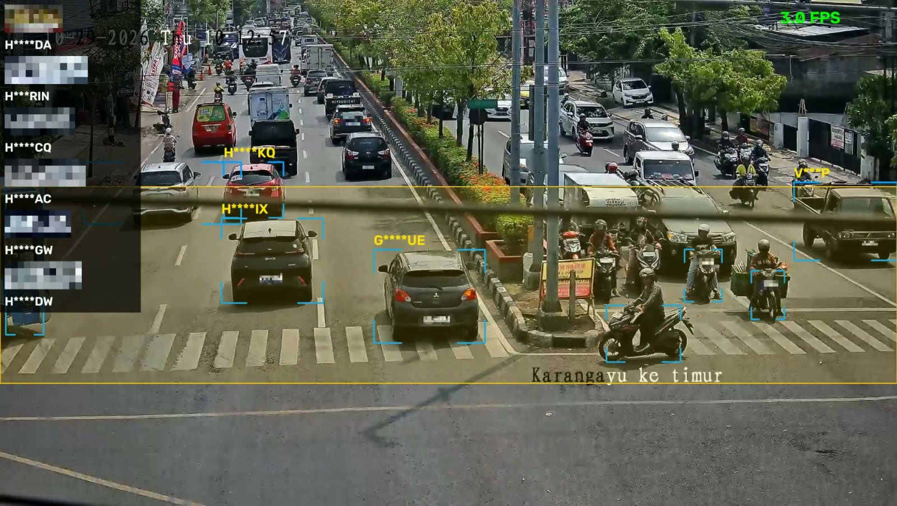

# yolo-cctv

Baca plat nomor kendaraan dari CCTV publik pakai YOLO + [fast-alpr](https://github.com/ankandrew/fast-alpr).



Demo CCTV Karangayu ke timur, Semarang.

## Cara kerja

```
stream CCTV (HLS/RTSP/file)
  → YOLO11n + ByteTrack        deteksi + tracking kendaraan
  → zona poligon               OCR cuma di area dekat garis stop
  → fast-alpr per kendaraan    deteksi plat (YOLOv9) + OCR
  → regex plat Indonesia       buang bacaan yang bukan format plat
  → voting per track           ambil bacaan terbanyak
  → SQLite + snapshot          out/plates.db, out/snapshots/
```

## Setup

Butuh [uv](https://docs.astral.sh/uv/) dan Python 3.12+.

```bash
git clone https://github.com/h-yusuf/yolo-cctv.git
cd yolo-cctv
uv sync
cp .env.example .env
```

Model di-download otomatis waktu pertama jalan.

## Config

Isi `.env`:

| Variabel | Isi |
|---|---|
| `CCTV_URL` | URL stream (`.m3u8` / `rtsp://`) atau file video |
| `ZONE` | `auto` (default) atau poligon manual `x,y x,y ...` |

Ganti kamera tanpa edit `.env`:

```bash
CCTV_URL=https://example.com/cam/index.m3u8 uv run alpr.py --show
```

### Zona

OCR cuma jalan buat kendaraan yang titik bawahnya ada di dalam zona.

- **Auto** (`ZONE=auto` atau kosong): pita selebar frame dari 25% sampai 85% tinggi frame. Ikut resolusi kamera, jadi bisa langsung dipakai di kamera mana aja.
- **Manual** (`ZONE=0,560 2688,560 2688,1150 0,1150`): poligon dalam piksel resolusi asli. Pakai ini kalau zona auto kena teks overlay kamera atau lajurnya nggak pas.

Zona yang dipakai di-print waktu start, jadi tinggal copy hasil auto lalu geser angkanya:

```
zone (auto, 1280x720): 0,180 1280,180 1280,612 0,612
```

Buat ukur koordinat manual, ambil satu frame dulu:

```bash
ffmpeg -i "$CCTV_URL" -frames:v 1 frame.jpg
```

URL CCTV Semarang bisa diambil dari [PANTAUSEMAR](https://pantausemar.semarangkota.go.id): buka kameranya, lalu DevTools → Network → filter `m3u8`.

Nggak semua CCTV bisa dipakai. Minimal 1080p, dekat lajur, dan lebar plat di zona sekitar 60 px. Kamera yang dipasang tinggi dengan sudut lebar biasanya cuma kuat buat deteksi kendaraan.

## Jalankan

```bash
uv run alpr.py --show                               # preview, q buat stop
uv run alpr.py --duration 120 --save out/demo.mp4   # rekam 2 menit
uv run alpr.py --source rekaman.mp4 --save out/hasil.mp4
uv run python test_alpr.py
```

| Flag | Default | |
|---|---|---|
| `--stride` | 3 | Proses tiap frame ke-N (stream live) |
| `--privacy` | off | Blur plat di video output |
| `--min-width` | 100 | Kendaraan lebih kecil dari ini (px) di-skip |
| `--min-votes` | 2 | Minimal bacaan sama sebelum disimpan |
| `--min-conf` | 0.7 | Minimal confidence OCR |
| `--dedupe-sec` | 60 | Plat sama/mirip dalam rentang ini cuma disimpan sekali |
| `--plate-model` | `yolo-v9-s-608-license-plate-end2end` | |
| `--ocr-model` | `cct-s-v2-global-model` | |

Lengkapnya: `uv run alpr.py -h`.

## Output

```bash
sqlite3 out/plates.db "select plate, votes, conf, vehicle, last_seen from plates order by id desc limit 20"
```

Kolom: `plate`, `votes`, `conf`, `vehicle`, `track_id`, `source`, `first_seen`, `last_seen`, `snapshot`.

## Hasil

Dites di CCTV Karangayu, MacBook M2:

- 5–8 FPS
- 4–5 plat per menit, kebanyakan mobil/truk yang berhenti di lampu merah
- Plat motor belum kebaca (terlalu kecil)
- Kadang salah 1 karakter

## Catatan

- HLS ngirim video per segmen sekaligus, jadi frame ditampung di buffer dulu, bukan cuma ambil frame terakhir.
- Kalau stream putus, otomatis reconnect.
- Dedupe pakai kemiripan teks, jadi dua plat yang mirip banget dalam 60 detik bisa kegabung.
- `out/` nggak ikut di-commit karena isinya data plat.
- Ultralytics YOLO lisensinya AGPL-3.0.
